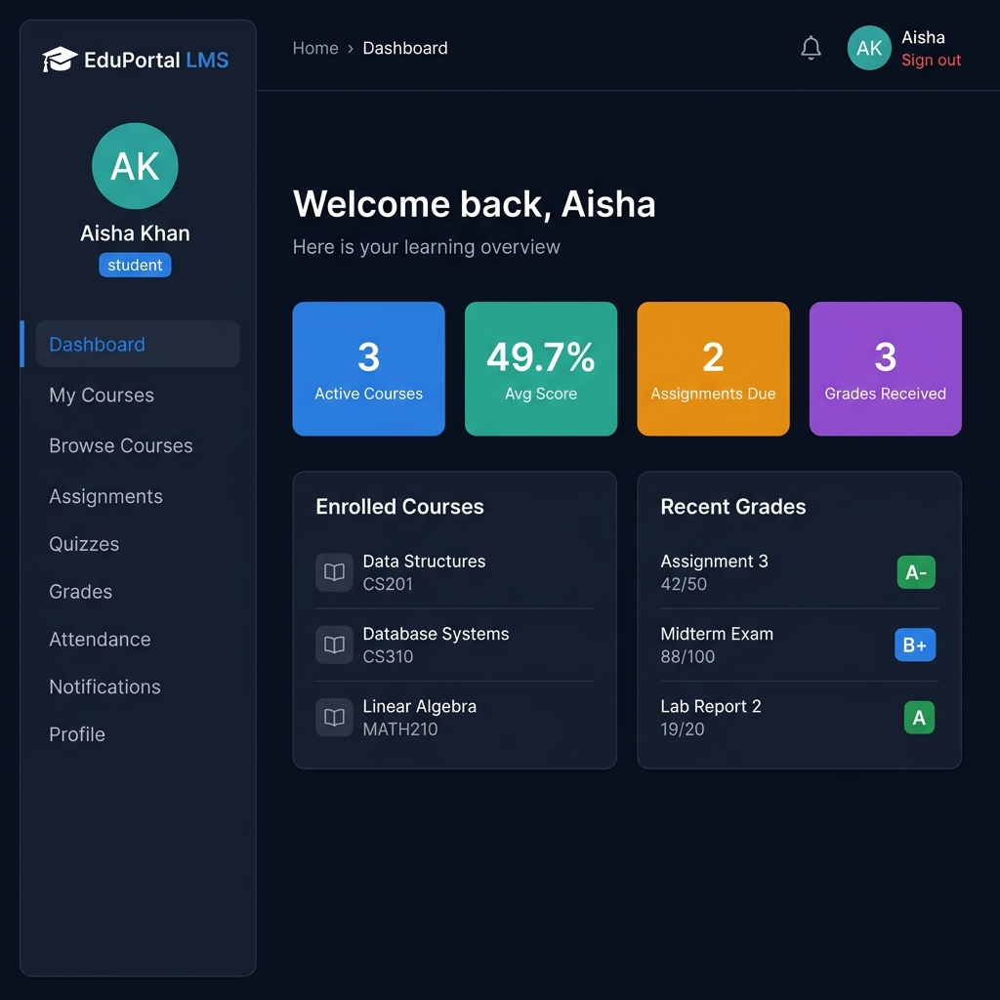
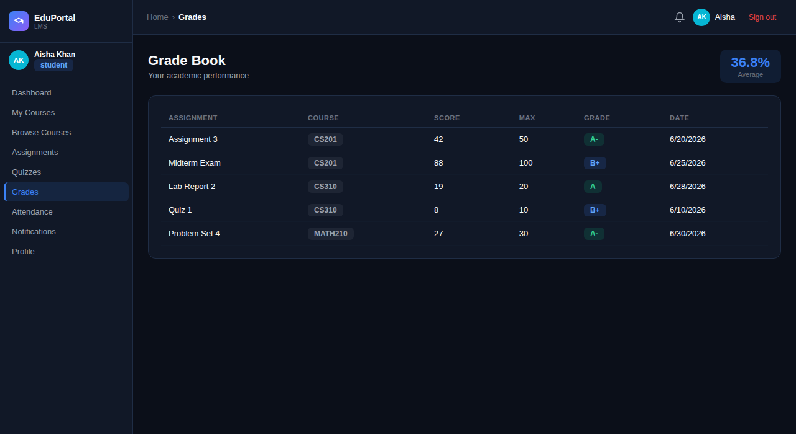
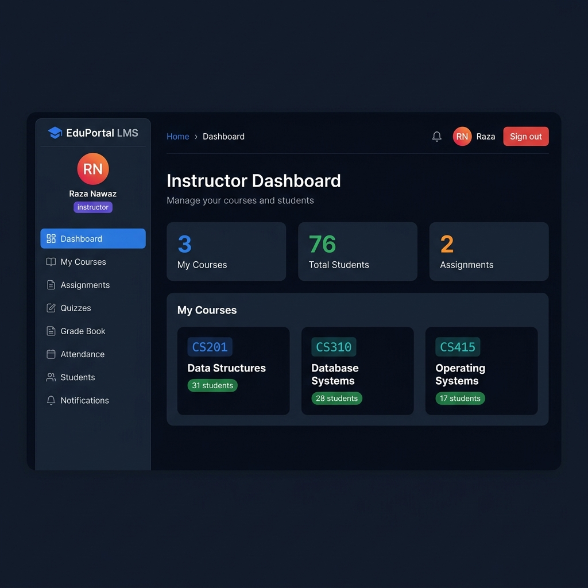
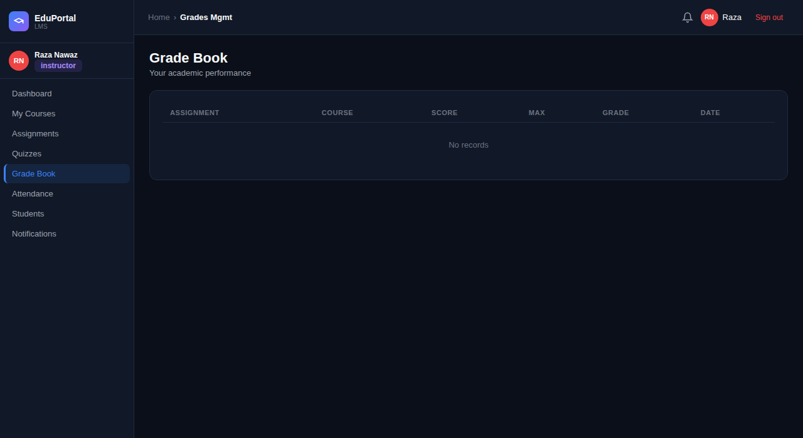
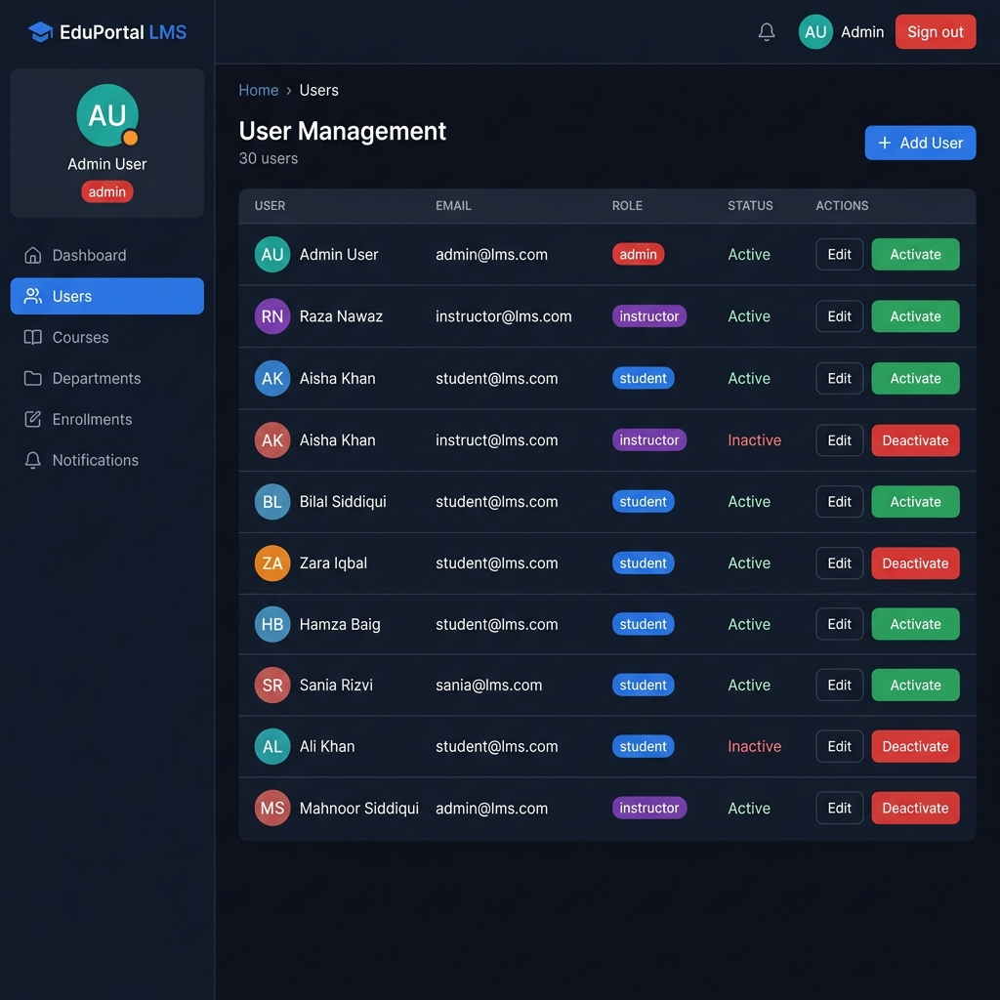
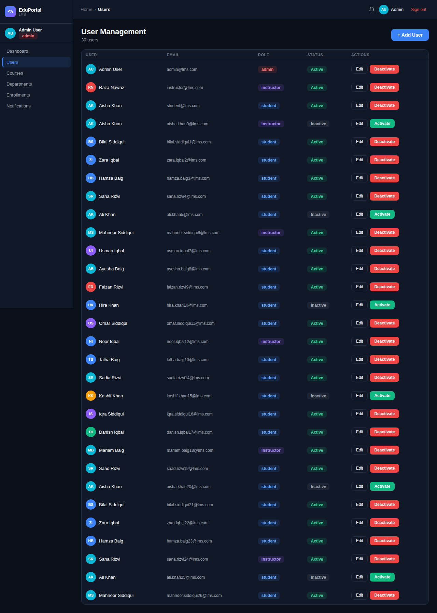

<div align="center">


# 🎓 EduPortal LMS

**A Polyglot Full-Stack Learning Management System powered by Node.js, Oracle Database XE, MongoDB & React**

[](https://nodejs.org)
[](https://react.dev)
[](https://vitejs.dev)
[](https://www.oracle.com/database/)
[](https://mongodb.com)
[](https://jwt.io)
[](LICENSE)

</div>

---

## 📌 Project Overview

**EduPortal LMS** is an enterprise-grade Learning Management System designed to handle university-wide course management, student enrollment, grading, attendance tracking, and real-time announcements. 

It features a hybrid **Polyglot Database Architecture**:
- **Oracle Database 21c (Sequelize ORM):** Handles relational domain entities (Users, Students, Instructors, Departments, Courses, Enrollments, Grades, Attendance, and Quizzes) enforcing strict relational schemas and foreign keys.
- **MongoDB (Mongoose ODM):** Handles semi-structured dynamic data (Notifications, Course Materials/Content, and Quiz Question Banks).

---

## 📸 Screenshots

### 🎓 Student Dashboard
> Students view active enrollments, GPA performance, upcoming assignment deadlines, and recent grade posting at a glance.



---

### 📊 Student Grade Book
> Comprehensive grade breakdown by course with numerical scores, letter grades, and submission dates.



---

### 👨‍🏫 Instructor Dashboard
> Instructors manage active course sections, track total enrolled students, and manage course materials.



---

### 📋 Instructor Grade Management
> Direct interface for instructors to enter, calculate, and publish student assignment & exam grades.



---

### 🛡️ Admin Dashboard & User Control
> System administrators possess central authority to create, update, activate, and deactivate users, manage departments, and assign course instructors.





---

## 🏗️ Technical Architecture

```
EduPortal LMS Workspace
├── backend/                  # Express.js REST API Server
│   ├── config/               # Oracle DB (Sequelize) & MongoDB (Mongoose) connections
│   ├── middleware/           # Auth JWT verification & role authorization
│   ├── models/               # Hybrid Data Models
│   │   ├── sql/              # Relational models (User, Student, Instructor, Course, etc.)
│   │   └── mongo/            # NoSQL models (Notification, QuizQuestions, CourseContent)
│   ├── routes/               # API Controllers and Endpoint Definitions
│   ├── .env.example          # Template for backend environment variables
│   └── server.js             # Express Server entry point
├── frontend/                 # React 19 + Vite Single Page Application
│   └── src/
│       ├── App.jsx           # Main React SPA component & UI views
│       └── api.js            # Axios/Fetch API client layer
└── docs/                     # Database schemas and screenshot assets
    ├── schema.sql            # Oracle Database DDL script
    └── images/               # Application UI screenshots
```

### Stack Summary

| Layer | Technology | Description |
|-------|-----------|-------------|
| **Frontend** | React 19 + Vite | Fast Single Page Application with clean modular styling |
| **Backend API** | Node.js + Express.js | RESTful API backend handling routing and auth |
| **SQL Storage** | Oracle XE 21c (Sequelize ORM) | Relational core for users, courses, grades, attendance |
| **NoSQL Storage** | MongoDB (Mongoose) | Flexible document store for notifications & rich course assets |
| **Security** | JWT + bcryptjs | Token-based stateless authentication & password hashing |
| **Access Control** | Role-Based Access Control | Granular permission levels for Student, Instructor, and Admin |

---

## ✨ System Features

### 🎓 Student Portal
- 📚 Course catalogue browsing & one-click enrollment
- 📝 Assignment submissions and deadline tracking
- 📊 Real-time grade card & GPA tracking
- 📅 Attendance log overview with percentage calculations
- 🔔 Dynamic notification inbox for system updates
- 🧪 Interactive quiz assessment module

### 👨‍🏫 Instructor Portal
- 🗂️ Course management and syllabus tracking
- ✍️ Assignment creation with max points and due dates
- 📋 Student grading portal with automated score updating
- 📌 Daily attendance tracker for enrolled students
- 📊 Class performance and enrollment analytics

### 🛡️ Admin Control Panel
- 👥 Comprehensive user lifecycle management (Register/Activate/Suspend)
- 🏛️ Department & academic program administration
- 📈 System-wide stats, course allocations, and global announcements

---

## 🔐 Role-Based Access Control (RBAC)

| Permission / Action | 🎓 Student | 👨‍🏫 Instructor | 🛡️ Admin |
|---------------------|:---:|:---:|:---:|
| View Enrolled Courses | ✅ | ✅ | ✅ |
| Browse Catalog & Self-Enroll | ✅ | ❌ | ✅ |
| View Personal Grades & Attendance | ✅ | ❌ | ✅ |
| Attempt Online Quizzes | ✅ | ❌ | ❌ |
| Create Assignments & Quizzes | ❌ | ✅ | ✅ |
| Enter & Publish Grades | ❌ | ✅ | ✅ |
| Mark Student Attendance | ❌ | ✅ | ✅ |
| Manage Department Courses | ❌ | ✅ | ✅ |
| Create & Manage User Accounts | ❌ | ❌ | ✅ |
| Create & Edit Departments | ❌ | ❌ | ✅ |

---

## 🚀 Getting Started

### Prerequisites

Ensure you have the following installed locally:
- **Node.js**: `v18.0.0` or higher
- **Oracle XE 21c**: Running on `localhost:1521`
- **MongoDB Community Server**: Running on `localhost:27017`
- **Git**

---

### 1️⃣ Oracle Database Setup

1. **Install Oracle Express Edition 21c**  
   Download from the official [Oracle XE Downloads](https://www.oracle.com/database/technologies/xe-downloads.html) page.

2. **Create Database User & Schema**  
   Open SQL*Plus or SQL Developer as `SYSDBA`:
   ```sql
   CREATE USER lms_user IDENTIFIED BY your_secure_password;
   GRANT CONNECT, RESOURCE, DBA TO lms_user;
   ```

3. **Execute SQL DDL Script**  
   Run the schema setup script provided in `docs/schema.sql`:
   ```bash
   sqlplus lms_user/your_secure_password@localhost:1521/XEPDB1 @docs/schema.sql
   ```

---

### 2️⃣ MongoDB Setup

1. **Start MongoDB Service**  
   - **Windows:** `net start MongoDB`
   - **macOS:** `brew services start mongodb-community`
   - **Linux:** `sudo systemctl start mongod`

2. Verify connectivity using **MongoDB Compass** at `mongodb://localhost:27017`.

---

### 3️⃣ Backend Setup

1. Navigate to the backend directory:
   ```bash
   cd backend
   ```

2. Install dependencies:
   ```bash
   npm install
   ```

3. Create the environment config file `.env`:
   ```bash
   cp .env.example .env
   ```

4. Open `.env` and fill in your Oracle DB password and JWT secret key:
   ```env
   ORACLE_USER=lms_user
   ORACLE_PASSWORD=your_secure_password
   ORACLE_HOST=localhost
   ORACLE_PORT=1521
   ORACLE_SID=ORCLPDB
   ORACLE_CONNECT_STRING=localhost:1521/ORCLPDB

   MONGO_URI=mongodb://localhost:27017/lms_db

   JWT_SECRET=super_secret_key_change_in_production_32chars
   JWT_EXPIRES_IN=7d

   PORT=5000
   NODE_ENV=development
   FRONTEND_URL=http://localhost:5173
   ```

5. Start the backend development server:
   ```bash
   npm run dev
   ```

---

### 4️⃣ Frontend Setup

1. Open a new terminal tab and navigate to the frontend directory:
   ```bash
   cd frontend
   ```

2. Install dependencies:
   ```bash
   npm install
   ```

3. Start the Vite development server:
   ```bash
   npm run dev
   ```
   The application will be accessible at **http://localhost:5173**.

---

### 5️⃣ Initializing Test Accounts (Seeding)

To seed initial accounts for each user role, send the following HTTP POST requests:

#### Admin Account
```bash
curl -X POST http://localhost:5000/api/auth/register \
  -H "Content-Type: application/json" \
  -d '{
    "first_name": "Admin",
    "last_name": "User",
    "email": "admin@lms.com",
    "username": "admin",
    "password": "Admin@1234",
    "role": "admin"
  }'
```

#### Instructor Account
```bash
curl -X POST http://localhost:5000/api/auth/register \
  -H "Content-Type: application/json" \
  -d '{
    "first_name": "Raza",
    "last_name": "Nawaz",
    "email": "instructor@lms.com",
    "username": "instructor",
    "password": "Instructor@1234",
    "role": "instructor"
  }'
```

#### Student Account
```bash
curl -X POST http://localhost:5000/api/auth/register \
  -H "Content-Type: application/json" \
  -d '{
    "first_name": "Aisha",
    "last_name": "Khan",
    "email": "student@lms.com",
    "username": "student",
    "password": "Student@1234",
    "role": "student"
  }'
```

Log in via the frontend interface at `http://localhost:5173`.

---

## 📄 License

This project is licensed under the [MIT License](LICENSE).

---

<div align="center">

Developed for University Database Systems Final Project — **EduPortal LMS**

</div>
